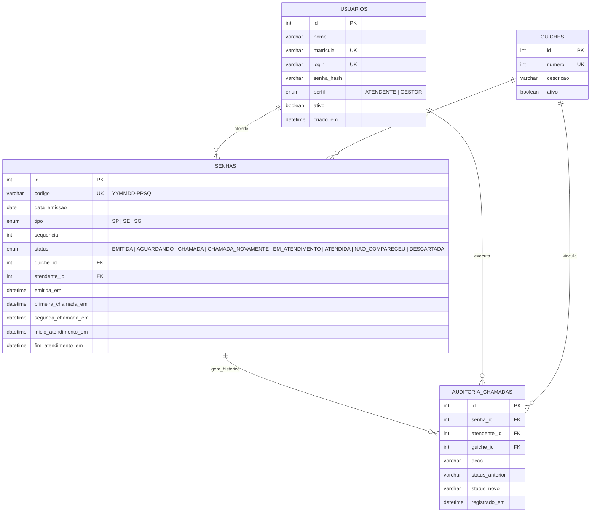

# Modelo Entidade-Relacionamento (MER) — nassauTickets

## Diagrama ER

## Dicionário de Dados Resumido

- **USUARIOS:** Armazena os Agentes Atendentes (`AA`) e o único usuário com perfil `GESTOR`.
- **GUICHES:** Cadastro dos guichês físicos do laboratório, todos aptos a atender qualquer prioridade.
- **SENHAS:** Tabela central das senhas emitidas, contendo o código formatado (`YYMMDD-PPSQ`), a máquina de estados e os timestamps exigidos pelos relatórios detalhado e de auditoria.
- **AUDITORIA_CHAMADAS:** Log cronológico de todas as transições de estado realizadas por atendentes e guichês.
